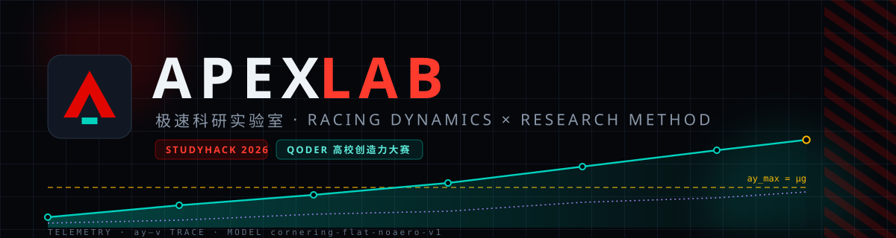
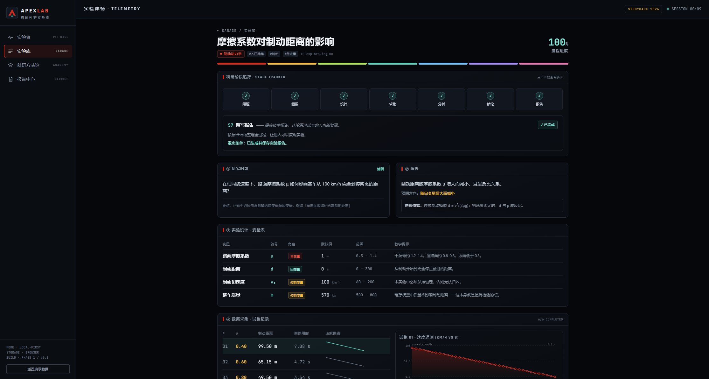
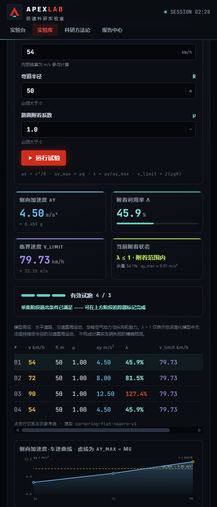
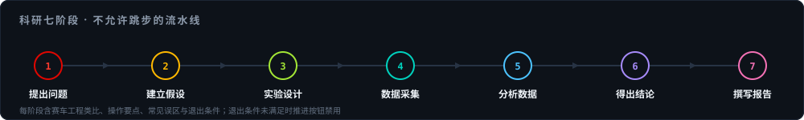
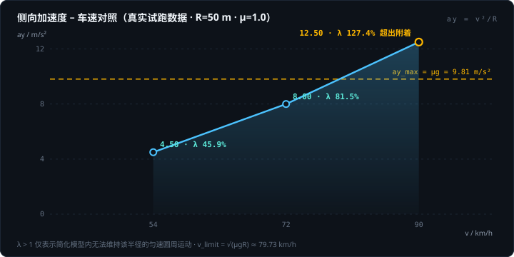

<p align="center">
  
</p>

<p align="center">
  
  
  
  
  
  
</p>

# ApexLab · 极速科研实验室

**像调校赛车一样做科研。** ApexLab 是一个面向科研初学者的交互式实验平台：把科学研究的基本流程拆成七个可执行、可校验的阶段，让学习者在赛车动力学实验（制动、过弯、空气动力学）中亲手完成「提出问题 → 建立假设 → 实验设计 → 数据采集 → 分析 → 结论 → 报告」的完整闭环。

本项目参加 **2026 Qoder 高校创造力大赛 · StudyHack 赛道**（[天池赛题页](https://tianchi.aliyun.com/competition/entrance/532536)），使用 Qoder 开发。无后端、无账号、无外部 AI 接口——全部数据保存在浏览器本地，开箱即跑。

---

## 为什么做 ApexLab

科研入门最大的障碍不是公式，而是**流程直觉**：为什么不能先跑数据再补假设？为什么一次只能改一个变量？为什么被推翻的假设也有价值？ApexLab 用赛车工程的语言回答这些问题——车队不会跳过风洞验证直接上赛道，科研也不允许跳过假设直接下结论。每个阶段都有赛车类比、操作要点、常见误区和**退出条件**：条件不满足，推进按钮就是禁用的。

## 核心功能

- **科研七阶段引擎**：阶段状态机（locked / active / done）+ 逐阶段退出条件校验，不允许跳步；阶段追踪器可点击查看每个阶段的教学要求。
- **过弯实验运行器**：手动输入车速 v（km/h）、弯道半径 R（m）、附着系数 μ，一键「运行试验」；实时给出侧向加速度 ay、附着利用率 λ、临界速度 v_limit 与附着状态，逐条保存为带唯一 ID、时间戳与模型版本的试跑记录。
- **三层数值安全**：输入校验（有限性 / 符号 / 溢出包络）→ 计算层全中间量有限性检查 → 写入前记录完整性拦截。任何非有限结果都不会进入存储，也不会被截断后当作正常数据。
- **历史数据容错**：localStorage 损坏时自动备份原始内容并回退种子数据；异常试跑记录被标记 `invalid` 并保留原值供排查，不计入有效试跑、不进入图表与报告；页面永不因脏数据白屏。
- **实验库**：搜索、分类筛选、三种排序、模板创建、两步确认删除；预置制动与过弯两个种子实验，首屏即有可信数据。
- **遥测图表**：零依赖 SVG 曲线（d–μ 反比曲线、ay–v 对照曲线带 μg 参考线、逐试跑速度遥测），超限数据点自动变色警示。
- **报告中心**：按「问题 → 假设 → 方法 → 数据 → 分析 → 结论 → 局限」标准结构生成 Markdown 报告，页面内预览、一键下载 `.md`。
- **本地持久化**：Zustand + localStorage，刷新、关页后实验与报告完整恢复；侧边栏可一键重置演示数据。

## 界面实拍

| 实验台 Pit Wall | 过弯运行器 Run Setup |
| --- | --- |
|  |  |

<p align="center">
  
</p>

<p align="center">
  
</p>

> 上图为三组验收试跑（54 / 72 / 90 km/h，R=50 m，μ=1.0）的真实记录绘制：ay = 4.50 / 8.00 / 12.50 m/s²，临界速度 ≈ 79.73 km/h；90 km/h 工况 λ=127.4% 超出附着极限。

## 快速开始

环境要求：**Node.js ≥ 18**（推荐 22）、npm ≥ 9。

```bash
git clone https://github.com/Zhanccg/ApexLeb.git
cd ApexLeb
npm install
npm run dev        # http://localhost:5173
```

| 命令 | 作用 |
| --- | --- |
| `npm run dev` | 启动开发服务器（端口 5173） |
| `npm run build` | TypeScript 全量类型检查 + 生产构建 |
| `npm test` | 运行 Vitest 测试套件（83 项） |
| `npm run preview` | 预览生产构建 |

三分钟体验路径：实验台 → 打开「弯道半径与极限过弯速度」→ 完成设计阶段 → 依次运行 54 / 72 / 90 km/h 三次试跑 → 标记采集完成 → 打开预置制动实验填写结论 → 报告中心生成并下载报告。

## 技术栈

| 层 | 选型 | 说明 |
| --- | --- | --- |
| 框架 | React 18 + TypeScript 5.6 | 严格模式，`strict` + `noUnusedLocals` |
| 构建 | Vite 6 | `@` 别名指向 `src/` |
| 样式 | Tailwind CSS 4 | `@theme` 设计令牌，碳纤维深色遥测视觉 |
| 状态 | Zustand 5 + persist | 单一数据源，localStorage 持久化 |
| 路由 | React Router 6 | 五个页面 + 深链接 |
| 图表 | 自研零依赖 SVG | `TelemetryChart` / `Sparkline`，支持参考线 |
| 字体 | Rajdhani + JetBrains Mono | `@fontsource` 本地打包，离线可用 |
| 测试 | Vitest 3 | 物理 / 校验 / 完整性 / 阶段规则 83 项 |

## 目录结构

```
src/
├── engine/          # 物理引擎：常量、车辆动力学纯函数、过弯简化模型与校验
│   ├── constants.ts     # G、空气密度、参考赛车参数
│   ├── vehicle.ts       # 制动距离 / 下压力 / 侧向加速度 / 临界速度
│   └── cornering.ts     # 输入校验、溢出包络、有限性检查、模型版本
├── pedagogy/        # 科研教学规则：七阶段定义、退出条件、推进校验
├── data/            # 数据管理：统一 Schema、模板、种子、Zustand 仓库、完整性容错
│   ├── schema.ts        # Experiment / Trial / TelemetrySample / ReportDoc …
│   ├── integrity.ts     # 记录完整性判定、无效标记、存储解析与清洗
│   └── store.ts         # 状态仓库 + 安全存储包装 + 写入拦截
├── report/          # 报告生成：Markdown 渲染与下载（纯函数）
├── components/      # AppShell / StageTracker / CorneringRunner / TelemetryChart / ui
├── pages/           # Dashboard / Experiments / ExperimentDetail / Learn / Reports
└── styles/          # Tailwind 主题令牌与遥测风格 utility
docs/                # 横幅、实拍截图、数据示意图
```

## 物理模型（过弯简化模型 v1）

```
v[m/s] = v[km/h] / 3.6          # 单位统一换算
ay     = v² / R                 # 侧向加速度 m/s²
ay_max = μ × 9.81               # 最大简化侧向加速度
λ      = ay / ay_max            # 附着利用率
v_limit = √(μ × 9.81 × R)       # 简化临界速度
```

模型假设：**水平道路、匀速圆周运动、忽略空气动力与纵向轮胎力**。
`λ > 1` 仅表示在该简化模型中无法维持指定半径的匀速圆周运动，**不构成对真实车辆失控的精确预测**——界面与报告均携带此声明。

安全计算包络：`v ≤ 10⁴ km/h`、`10⁻³ ≤ R ≤ 10⁶ m`、`10⁻³ ≤ μ ≤ 10²`。包络内任意组合的全部中间量均远离浮点溢出边界；包络外即使输入有限也拒绝计算，并提示「当前参数可能导致数值计算溢出，请调整速度、半径或附着系数。」

## 数据契约（供 T04 / T05 复用）

每条试跑记录（`Trial`）可识别：实验 ID（父级）、试跑 ID、序号、时间戳、参数、指标、遥测样本、模型版本与无效原因。

```ts
interface Trial {
  id: string;                 // 唯一 ID
  index: number;              // 试跑序号
  params: Record<string, number>;   // 过弯：speedKmh / radiusM / mu（键名即单位）
  metrics: Record<string, number>;  // lateralAccelMs2 / gripUtilization / limitSpeedKmh / limitSpeedMs
  samples: TelemetrySample[];       // 逐帧通道：speed / lateralAccelMs2 / gripUtilization / distance
  status: 'planned' | 'running' | 'completed' | 'invalid';
  note: string;
  createdAt: string;          // ISO 时间戳
  modelVersion?: string;      // 'cornering-flat-noaero-v1'
  invalidReason?: string;     // 历史容错标记原因（原值保留）
}
```

- **T04 控制变量检查**：直接比较 `params` 三键；以 `modelVersion` 过滤模型一致性；`status === 'invalid'` 的记录不参与对照。
- **T05 分析与 CSV**：`metrics` 四键 + `samples` 通道即分析数据源；`TelemetryChart` 已支持参考线与超限变色；分析发现通过 `evidenceTrialIds` 回溯到具体试跑。

## 可靠性设计

1. **输入层**：拒绝空值 / 非数字 / 负速度 / 非正半径 / 非正 μ / 包络外极端有限值，错误显示在对应字段旁。
2. **计算层**：`computeCorneringRun` 检查 vMs、ay、ay_max、v_limit、λ 全部中间量与输出；非有限即返回失败，不保存、不修改既有记录。
3. **写入层**：`addTrial` 对候选记录再做完整性判定，非有限数值无法进入持久化存储。
4. **读取层**：存储 JSON 损坏 → 原始串备份至 `apexlab-store-v1.corrupt-backup` → 回退种子数据；记录级异常 → 标记 `invalid` + 原因并落盘，原值保留；UI 全链路安全格式化，脏数据不崩溃、不计数、不入图、不入报告。

## 测试

```bash
npm test    # 83 passed (3 files)
```

| 套件 | 数量 | 覆盖 |
| --- | --- | --- |
| `engine/cornering.test.ts` | 41 | 单位换算、三组验收值、临界速度、λ 与状态、零速度、九种非法输入、溢出包络、绕过校验的极端值拒绝、制动模型回归 |
| `data/integrity.test.ts` | 39 | Infinity/NaN/null/字符串指标、JSON `1e999` 溢出、无效标记保留原值、实验级清洗、损坏 JSON 解析、安全格式化 |
| `pedagogy/rules.test.ts` | 3 | 无效记录不满足采集退出条件、有效计数排除无效、不足三次拒绝推进 |

浏览器实测（Chrome）：三组试跑保存与刷新恢复、阶段推进、极端输入拦截、异常历史恢复、损坏存储回退与备份、报告生成下载、控制台无错误、窄视口无横向溢出。

## 路线图

当前状态：T01 基础入口、T07 Markdown 原型已验收；**T03 过弯运行与数据容错已实现并自测通过，待独立复核**；其余任务排期见 [ROADMAP.md](ROADMAP.md)。

| 任务 | 内容 | 状态 |
| --- | --- | --- |
| T04 | 假设 / 变量编辑与跨试次控制变量纠错 | 计划 |
| T05 | 有效对照集分析、证据引用与 CSV 导出 | 计划 |
| T06 | 过弯结论到报告的全流程三分钟闭环 | 计划 |
| T08 | 打印 / PDF、教学反馈与二维模型示意 | 计划 |
| T09–T10 | Qoder Sites 公开部署与提交材料 | 计划 |

项目文档：[PROJECT_BRIEF.md](PROJECT_BRIEF.md) · [DECISIONS.md](DECISIONS.md) · [QA_CHECKLIST.md](QA_CHECKLIST.md) · [PROGRESS.md](PROGRESS.md)

## 设计语言

深色碳纤维基底 + 赛车遥测信号色：品牌赛车红 `#e10600`、遥测青 `#00d2be`、信号琥珀 `#ffb800`、酸绿 `#a3e635`、冰蓝 `#4cc3ff`、紫 `#a78bfa`、品红 `#f471b5`，七阶段一一对应；Rajdhani 显示字体 + JetBrains Mono 遥测数字；扫描线、LED 脉冲与曲线描边动画克制地服务于「数据正在流动」的感知。

---

<p align="center">
  <sub>APEXLAB · RACING DYNAMICS × RESEARCH METHOD · 2026 Qoder 高校创造力大赛 · StudyHack</sub>
</p>